  

### About

Python / TypeScript developer from Moscow. I build backends, Telegram bots and servers, automate work with AI agents (Claude Code, MCP, n8n), and mod games in my spare time. Third-year student at RTU MIREA, Institute of Cybersecurity and Digital Technologies. I also make music.

### Projects

| Project | What it is | Stack |
|---|---|---|
| **[Egging On Co-op](https://github.com/LiteS1de/egging-on-coop)** | Co-op mod for a single-player game: up to 4 players in one world, Steam invites, emotes, pings and Twitch viewer effects | C#, Unity, BepInEx, Harmony |
| **Departament VPN** | Subscription service I co-founded: Telegram bot, Mini App, website and backend API, 9 servers in 8 countries, ~330 subscribers | TypeScript, Node.js, PostgreSQL, Prisma, React, Docker |
| **Drawing quantity checker** | Counts concrete, rebar, cables and equipment straight from DWG and PDF drawings and checks them against the designer's bill of quantities. It found real mistakes, including ~7 t of missing rebar | Python, ezdxf, PyMuPDF, C# AutoCAD plugin, Claude API |
| **huEVO** | A social network in the spirit of old VK, built by a team of 7. My part is infrastructure and CI/CD | Docker Compose, PostgreSQL, Nginx, GitHub Actions, Prometheus |
| **Trading bot research** | A replay simulator (~1% off live trading) and a backtest system for a spot DCA bot, with 24/7 market data collection | TypeScript, Python, pandas, scikit-learn |
| **n8n + AI automation** | A Telegram assistant that sorts messages into Notion, Calendar and Sheets, and a freelance order finder scored by an LLM | n8n, Python, PostgreSQL, LLM APIs |

<b>Smaller things</b>

- **Test Drive Unlimited 2:** force feedback for the Moza R5 wheel through my own DirectInput hook DLL in C
- **Factorio AI:** an agent that builds the base together with the player, through my own Lua mod and a Python bridge
- **TouchDesigner:** music-reactive visuals controlled by an AI agent
- **Open source:** fixes in Rust CAD projects (cadcraft, acadrust)

### Tools

  
  
  
  
  
   
  
  
  
  
  
   
  
  
  
  

### Activity

  

<picture>
  <source media="(prefers-color-scheme: dark)" srcset="https://raw.githubusercontent.com/LiteS1de/LiteS1de/output/snake-dark.svg">
  <source media="(prefers-color-scheme: light)" srcset="https://raw.githubusercontent.com/LiteS1de/LiteS1de/output/snake.svg">
  
</picture>

<b>По-русски</b>

Python / TypeScript-разработчик из Москвы. Делаю backend, Telegram-ботов и серверы, автоматизирую работу с помощью AI-агентов (Claude Code, MCP, n8n), в свободное время делаю моды для игр. Учусь на 3 курсе РТУ МИРЭА, Институт кибербезопасности и цифровых технологий.

Проекты: кооп-мод [Egging On Co-op](https://github.com/LiteS1de/egging-on-coop), VPN-сервис по подписке Departament VPN (сооснователь), программа проверки объёмов работ по чертежам DWG и PDF, инфраструктура соцсети huEVO, исследование торгового бота и автоматизация на n8n.

