  

  
  

### About

I make music and I make games playable with friends.

- **Music:** producer, beatmaker and DJ, beats and sets on [YouTube](https://www.youtube.com/channel/UCSYM0PaA3pODz81L79rRe5Q)
- **Mods:** co-op for single-player games, now [Egging On Co-op](https://github.com/LiteS1de/egging-on-coop) with Steam invites, a shared world and Twitch viewer effects
- **Study:** Russian Technology University
- **Speaks:** Russian, English

### Featured

  

### Tools

  
  
  
  
  
  
  
  

### Activity

  

<picture>
  <source media="(prefers-color-scheme: dark)" srcset="https://raw.githubusercontent.com/LiteS1de/LiteS1de/output/snake-dark.svg">
  <source media="(prefers-color-scheme: light)" srcset="https://raw.githubusercontent.com/LiteS1de/LiteS1de/output/snake.svg">
  
</picture>

<b>По-русски</b>

Привет! Я LiteS1de: пишу музыку, делаю биты и играю диджей-сеты, а ещё делаю кооператив для игр, которые задумывались для одного. Учусь в Российском технологическом университете.

Сейчас делаю [кооп-мод для Egging On](https://github.com/LiteS1de/egging-on-coop): до 4 игроков в одном мире, подключение через Steam, эмоции, метки, доска позора и эффекты от зрителей Twitch.

