  

### Hi, I'm LiteS1de

I take games that were made for one player and make them playable with friends. I'm also a music producer, beatmaker and DJ, and a student at the Russian Technology University.

- **Now:** co-op for Egging On, with Steam invites, a shared world and Twitch viewer effects
- **Music:** beats and DJ sets on [YouTube](https://www.youtube.com/channel/UCSYM0PaA3pODz81L79rRe5Q)
- **Speaks:** Russian, English

### Featured project

  <a href="https://github.com/LiteS1de/egging-on-coop"><b>Egging On Co-op</b></a>: up to 4 players in one world, teleports, emotes, pings, a shame board, 
  a streamer mode and Twitch effects. BepInEx plugin, C#, MIT.

  
  
  

### Tools

  
  
  
  
  
  
  
  

### Activity

  

<picture>
  <source media="(prefers-color-scheme: dark)" srcset="https://raw.githubusercontent.com/LiteS1de/LiteS1de/output/snake-dark.svg">
  <source media="(prefers-color-scheme: light)" srcset="https://raw.githubusercontent.com/LiteS1de/LiteS1de/output/snake.svg">
  
</picture>

<b>По-русски</b>

Привет! Я LiteS1de: делаю кооператив для игр, которые задумывались для одного, а ещё пишу музыку, делаю биты и играю диджей-сеты. Учусь в Российском технологическом университете.

Сейчас делаю [кооп-мод для Egging On](https://github.com/LiteS1de/egging-on-coop): до 4 игроков в одном мире, подключение через Steam, эмоции, метки, доска позора и эффекты от зрителей Twitch.

